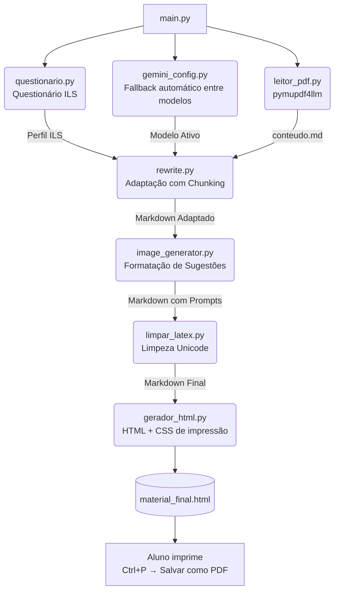

# Sistema de Personalização de Materiais Didáticos

Sistema acadêmico desenvolvido no âmbito do **Mestrado em Ciência da Computação — UFMA**, cujo objetivo é adaptar automaticamente materiais didáticos em PDF ao perfil cognitivo de cada estudante, com base no modelo de estilos de aprendizagem de **Felder-Silverman (ILS)** integrado à **API Gemini (Google AI)**.

---

## 📂 Arquitetura do Projeto

```text
projeto_bkb/
├── main.py                          # Orquestrador do pipeline completo
├── limpar_latex.py                  # Pós-processamento de segurança (LaTeX -> Unicode)
├── requirements.txt                 # Dependências Python (sem bibliotecas de sistema)
├── README.md                        # Este arquivo
├── CHANGELOG.md                     # Histórico de correções e decisões de design
├── .env                             # API key do Gemini — NÃO versionar
├── disciplina.pdf                   # Material base em PDF — fornecido pelo professor
├── materiais_gerados/               # Saída: material_<timestamp>.html e .md
└── modulos/
    ├── aluno/
    │   └── questionario.py          # Questionário ILS e mapeamento de dimensões
    ├── llm/
    │   ├── gemini_config.py         # Conexão com o Gemini, fallback entre modelos e tratamento de erros
    │   ├── rewrite.py               # Adapta o conteúdo ao perfil do aluno (chunking + validações)
    │   └── image_generator.py       # Formata sugestões de imagens para o perfil Visual
    ├── pdf/
    │   ├── leitor_pdf.py            # Converte PDF → Markdown (pymupdf4llm)
    │   └── gerador_html.py          # Renderiza Markdown → HTML pronto para impressão
    └── utils/
        └── progresso.py             # Heartbeat de progresso para chamadas bloqueantes (LLM)
```

---

## ⚙️ Como Funciona

Ao executar `python main.py`, o pipeline percorre as seguintes etapas:

### 1. Questionário ILS (`modulos/aluno/questionario.py`)
O aluno responde ao questionário **ILS**, que mapeia as quatro dimensões de Felder-Silverman. A escolha do modelo de IA é **automática** — não há nada a configurar durante a execução:

| Dimensão | Opção A | Opção B |
|---|---|---|
| Compreensão | Sequencial | Global |
| Percepção | Sensorial | Intuitivo |
| Entrada | Visual | Verbal |
| Processamento | Ativo | Reflexivo |

### 2. Conversão PDF para Markdown (`modulos/pdf/leitor_pdf.py`)
O PDF do material é processado via `pymupdf4llm`. O conteúdo é extraído de forma estruturada para Markdown, garantindo que tabelas e hierarquias sejam preservadas para melhor compreensão da IA.

O sistema prioriza o nome `disciplina.pdf`, mas aceita **qualquer PDF único** na pasta do projeto (com qualquer nome). Se o PDF não render texto suficiente — por ser apenas digitalizações sem OCR possível, estar protegido ou corrompido — o programa aborta com um diagnóstico claro, em vez de gerar um material vazio.

### 3. Adaptação Pedagógica com Chunking (`modulos/llm/rewrite.py`)
O material integral é processado em blocos de até **8.000 caracteres**, divididos respeitando fronteiras de parágrafo (para não cortar frases, listas ou tabelas no meio). Cada bloco recebe o **Sumário Global** como contexto para evitar perda de coesão. A IA adapta o **tom, exemplos e estrutura** conforme o perfil ILS — mas nunca a substância do conteúdo original (ver [Regras de Fidelidade e Validação](#-regras-de-fidelidade-e-validação) abaixo).

O prompt é **independente de disciplina**: funciona igualmente para Lógica, História, Química, Direito etc., sem conteúdo específico de uma área embutido.

### 4. Geração de Sugestões Visuais (`modulos/llm/image_generator.py`)
Para perfis **Visuais**, a IA insere tags `[SUGESTAO_IMAGEM]`. Este módulo identifica essas tags e as transforma em blocos de citação formatados com prompts detalhados para geração manual em IAs geradoras de imagem.

### 5. Limpeza de LaTeX (`limpar_latex.py`)
Um passo de segurança que varre o material adaptado em busca de sintaxe LaTeX residual (como `$...$`), convertendo-a para caracteres **Unicode** (como ¬, ∧, ∨, →). Isso garante que o material final seja legível em qualquer dispositivo sem necessidade de bibliotecas matemáticas complexas.

### 6. Geração da Página HTML Final (`modulos/pdf/gerador_html.py`)
O material é renderizado em uma **página HTML autocontida** (CSS embutido, sem dependências externas), com tema inspirado no GitHub e cabeçalho personalizado. A página abre automaticamente no navegador ao final da execução. Caso queira uma versão em PDF, o próprio aluno usa a impressão nativa do navegador (`Ctrl+P` / `⌘+P` → *“Salvar como PDF”*) — a página não adiciona botões para isso, já que o navegador resolve nativamente.

O CSS inclui regras `@media print` que preparam essa impressão nativa: as cores de fundo são preservadas, o tamanho de página é A4 com margens de 2 cm, títulos não ficam órfãos no fim da página, e tabelas, blocos de código e citações não são quebrados no meio entre páginas.

> **Por que HTML em vez de gerar o PDF direto?** A geração de PDF no servidor dependia do WeasyPrint, que por sua vez exige as bibliotecas de sistema Pango e Cairo (instalação via Homebrew no macOS, `apt-get` no Linux) — a maior fonte de atrito de instalação do projeto. Imprimindo pelo navegador, o projeto passa a depender apenas de bibliotecas Python puras.

---

## 🛡️ Regras de Fidelidade e Validação

Ao testar o pipeline com material real, identificamos e corrigimos classes de problema que podem surgir na resposta do modelo de IA. As regras abaixo estão implementadas no prompt de sistema e na validação automática de `modulos/llm/rewrite.py`, e valem para **qualquer disciplina**:

- **Fidelidade ao conteúdo original:** a IA adapta apenas a forma (tom, exemplos de apoio, estrutura) — nunca corrige, questiona ou substitui dados/exemplos/afirmações do material do professor, mesmo que perceba uma possível inconsistência. Isso preserva a rastreabilidade: um erro no material final deve ser atribuível à fonte, não a uma "correção" silenciosa da IA.
- **Proibição de ressalvas e meta-comentários:** não basta não corrigir. A IA também não pode acrescentar notas, ressalvas ou alertas sugerindo que algo no material parece inconsistente — e nunca deve se referir à fonte como uma terceira entidade ("o texto original diz...", "a tabela original indica..."). Para o aluno, o material adaptado é a única fonte; ele não deve sequer perceber que houve um processo de adaptação.
- **Proibição de vazamento de raciocínio interno:** a resposta final deve conter apenas o texto já polido, nunca rascunhos, dúvidas ou autocorreções expostas (ex.: "Self-correction", "Wait,", "Okay, so") nem mistura de inglês em meio ao texto em português.
- **Nenhum conteúdo externo ao material:** a IA não pode citar leis, teoremas, princípios, métodos, autores, normas ou classificações que não estejam no material do professor — mesmo que corretos na literatura da área. Isso mantém o material alinhado ao recorte exato da ementa.
- **Profundidade proporcional ao bloco:** a extensão da resposta acompanha o que está realmente no trecho original. É proibido gerar conteúdo de "preenchimento" sobre tópicos ausentes — o que antes inflava o material e desperdiçava tokens.
- **Uso adequado de tabelas:** tabelas servem para comparar dados curtos lado a lado. Parágrafos longos de análise dentro de células são proibidos (geram linhas altíssimas com colunas vazias, ilegíveis na impressão) — a explicação deve vir em parágrafos abaixo da tabela.

### Validação automática

A função `detectar_vazamento_raciocinio()` varre cada bloco gerado em busca de marcadores que indicam violação dessas regras — tanto raciocínio bruto exposto quanto meta-comentário sobre a fonte. Ao detectar um caso, o sistema reescreve **apenas o trecho afetado** com uma chamada pequena à IA, em vez de regenerar o bloco inteiro.

Os padrões detectam a **forma** do comentário, nunca o assunto, para funcionar em qualquer disciplina sem bloquear conteúdo legítimo. Por exemplo: "a **tabela original** indica..." é sinalizado, enquanto "o **documento original** do Tratado de Tordesilhas" (História), "a **reação original** de Fischer" (Química) e "Tautologia/**Contradição**" (Lógica) passam sem alarme falso.

Detalhes de quando e por que cada regra foi criada estão no [CHANGELOG.md](CHANGELOG.md).

---

## 🔄 Fluxograma



---

## 🚀 Como Executar

### Pré-requisitos

- Python 3.10+
- Um navegador (para visualizar o material e salvar em PDF)

Não há dependências de sistema a instalar: o projeto usa apenas bibliotecas Python puras.

### Instalação

```bash
# Clone o repositório
git clone <url-do-repositorio>
cd projeto_bkb

# Crie e ative o ambiente virtual
python -m venv .venv
source .venv/bin/activate

# Instale as dependências
python -m pip install -r requirements.txt
```

### Configuração

Crie um arquivo `.env` na raiz do projeto com sua chave da API Gemini:

```env
GEMINI_API_KEY=sua_chave_aqui
```

> Obtenha sua chave em: [https://aistudio.google.com/app/apikey](https://aistudio.google.com/app/apikey)

O sistema usa exclusivamente o Gemini, com fallback automático entre modelos (`gemini-2.5-flash` → `gemini-3.8-flash` → `gemini-3.1-flash-lite`) caso um deles atinja o limite de cota. Cada chamada tem um **timeout de 90s** — se o modelo não responder nesse prazo, o sistema não fica travado esperando.

### Uso

1. Coloque o material da disciplina em PDF na raiz do projeto (de preferência como `disciplina.pdf` — mas qualquer PDF único na pasta é aceito, com qualquer nome)
2. Execute o programa:

```bash
python main.py
```

3. Responda o questionário ILS no terminal e aguarde a adaptação.
4. Ao final, a página HTML abre automaticamente no navegador. Para guardar uma cópia em PDF, use a impressão do próprio navegador (`Ctrl+P` / `⌘+P`) e escolha *“Salvar como PDF”*.

Os arquivos gerados ficam em `materiais_gerados/`: a página `.html` e a versão bruta em `.md` do conteúdo retornado pela IA.

---

## 📚 Referências

- Felder, R. M., & Silverman, L. K. (1988). *Learning and Teaching Styles in Engineering Education*.
- Troussas, C. et al. (2020). *Adaptive Learning Rate Based on Entropy*. Entropy, MDPI.
- Vaccaro, M. et al. (2025). *LLM-based Adaptive Content Generation*.
- [pymupdf4llm](https://github.com/pymupdf/RAG) — Extração de PDF otimizada para LLMs
- [Python-Markdown](https://python-markdown.github.io/) — Conversão de Markdown para HTML

---

## ⚠️ Observações e Envio ao GitHub

- O arquivo `.env` **não deve ser versionado**. Para evitar vazamento de chaves de API, certifique-se de ter um arquivo `.gitignore` no projeto. O projeto foi atualizado com um arquivo pronto.
- Os arquivos `.pdf` de origem e os conteúdos em `materiais_gerados/` e os arquivos temporários `.md` também são bloqueados pelo `.gitignore` para não lotar seu repositório.
- Deve subir no GitHub apenas: `main.py`, `limpar_latex.py`, `requirements.txt`, `.gitignore`, a documentação (`README.md`, `CHANGELOG.md`, `Pre-Readme.md`) e a pasta `modulos/` (somente os `.py`, sem `__pycache__`).
- O modelo Gemini é escolhido **automaticamente**, sem interação: o sistema tenta `gemini-2.5-flash` e, se houver falha ou estouro de cota, passa sozinho para `gemini-3.8-flash` e depois `gemini-3.1-flash-lite`.
- Existe um módulo legado `modulos/llm/assuntos_llm.py` (escolha de assunto pelo aluno) reservado para uma segunda versão do projeto — hoje o pipeline adapta o material integral da disciplina, sem essa escolha.
- Para o histórico de correções de bugs e decisões de design, consulte o [CHANGELOG.md](CHANGELOG.md).
